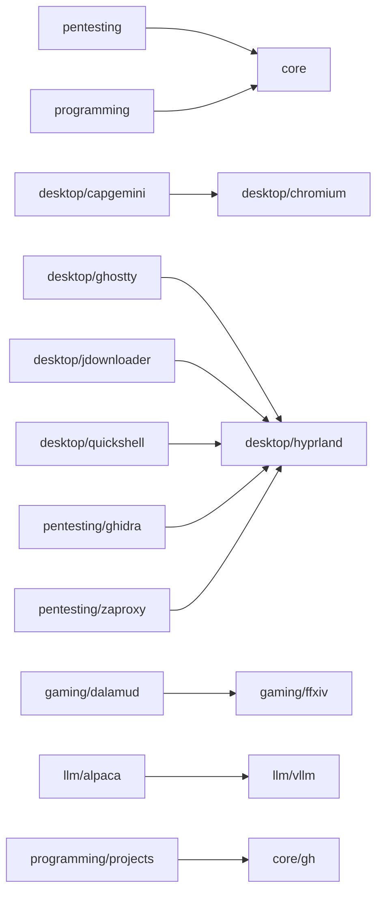

# Generated reference

<!-- generated by dot gen from the tree, do not edit; dot test lint fails when it drifts -->

What the tree declares, derived from it: edit the files named here, then run `dot gen`.

## Platforms

`platforms/<host>.nuon`: the groups each machine installs and configures (none set means every group).

| platform | groups |
|---|---|
| luca-notebook | base core fonts desktop socials creating latex programming pentesting |
| luca-pc | base core fonts desktop socials gaming creating latex programming qemu llm rocm pentesting |
| luca-wsl | base core programming |
| test-vm | base core fonts desktop socials gaming creating latex programming qemu llm pentesting |

## Groups and modules

A module is a dir under `configs/<group>/` with a `mod.nu`: `user` for a link, theme or apply verb, `system` for a
system verb, `test` for a `*.test.nu` or `*.test.sh` beside it. Base is every group's implicit dependency.

### base

| module | layers |
|---|---|
| apparmor | user, system, test |
| boot/hardening | system |
| boot/luks | system |
| boot/remote-unlock | system |
| boot/sbctl | system |
| boot/systemd-boot | system |
| boot/timeshift | system |
| cleanup | user, system |
| coredump | system |
| dot | system |
| endlessh | system |
| essentials |  |
| fail2ban | system |
| failure-notify | user, system |
| fancontrol | system |
| fprintd | system |
| fwupd | system |
| ghostmirror | system |
| hardening | system |
| hardware | system |
| i2c | system |
| lact | system |
| networkmanager | system |
| nftables | system |
| oomd | user, system |
| ossec | system |
| pacman | user, system |
| pam | system |
| perf | system |
| plymouth | system |
| portmaster | user, system |
| powercap | system |
| protonvpn | user |
| protonvpn-netns | system |
| resolved | system |
| sandbox | user |
| scx | system |
| smartd | system |
| ssh | user, system |
| sudo | system |
| systemd | user, system |
| tablet | system |
| tlp | system |
| tor | system |
| v4l-utils | system |
| v4l2loopback | user, system |
| wireguard | system |
| xdg | user, system |
| yubikey | user, system |
| zram | system |

### core

| module | layers |
|---|---|
| borg | user |
| btop | user |
| cli |  |
| fastfetch | user |
| gh | user |
| git | user |
| gnupg | user |
| herdr | user |
| locale | system |
| nas | user, system |
| ntfy | user |
| nushell | user |
| proton/pass | user |
| starship | user |
| syncthing | user |
| timezone-auto | user, system |
| tmux | user |
| toggles | system |
| trash | user |
| veracrypt | user |
| wallust | user |
| yazi | user |
| yt-dlp | user |
| zsh | user |

### creating

| module | layers |
|---|---|
| apps |  |
| audacity | user |
| blender | user |
| gimp | user |
| inkscape | user |
| krita | user |
| obs | user |
| openscad | user |

### desktop

| module | layers |
|---|---|
| applications | user |
| bookokrat | user |
| capgemini | user |
| chromium | user, system |
| color-grading | user |
| feather | user |
| firefox | user, system |
| ghostty | user |
| gparted | user, system |
| gtk | user |
| hyprland | user |
| idle-guards | user |
| jdownloader | user |
| kitty | user |
| konsole | user |
| libreoffice | user |
| ly | system |
| mpv | user |
| nsxiv | user |
| obsidian | user |
| oomox | user |
| pipewire | user |
| plasma | user |
| printing | system, test |
| qbittorrent | user |
| quickshell | user |
| qutebrowser | user |
| shimoji |  |
| thunderbird | user |
| uwsm | user |
| zathura | user |

### fonts

| module | layers |
|---|---|
| fonts | user |

### gaming

| module | layers |
|---|---|
| dalamud | user |
| emulators |  |
| ffxiv | user |
| gamemode | user, system |
| games |  |
| lutris | user |
| mangohud | user |
| modrinth | user |
| nethack | system |
| protonup | user |
| runtime |  |
| steam | user |
| vkbasalt | user |
| vpn-bypass | system |
| vr |  |

### latex

| module | layers |
|---|---|
| latex | user |
| sioyek | user |
| zotero | user |

### llm

| module | layers |
|---|---|
| alpaca | user |
| ollama | user, system |
| tools |  |
| vllm | system |

### pentesting

Depends on: core.

| module | layers |
|---|---|
| caido | user |
| ghidra | user |
| metasploit | user |
| netscanner | system |
| nuclei | user |
| pentest | user, system |
| proxychains | user |
| rustscan | user |
| seclists | user |
| toolkit |  |
| wireshark | user, system |
| zaproxy | user |

### programming

Depends on: core.

| module | layers |
|---|---|
| asm-lsp | user |
| bruno | user |
| bugwarrior | user |
| cargo | user |
| caveman | user |
| cgdb | user |
| claude | user |
| copilot | user |
| debugging |  |
| devtools |  |
| direnv | user |
| docker | user, system |
| elan | user |
| emacs | user |
| flux | user |
| formatting | user |
| gdb | user |
| gemini-cli | user |
| gh-dash | user |
| ghcup | user |
| godot | user |
| grafana | user |
| hermes | user |
| http |  |
| infra |  |
| jai | user |
| jetbrains | user |
| kani | user |
| kubernetes | user |
| lazygit | user |
| math |  |
| nix | user, system |
| nnd | user |
| nvim | user |
| opam | user |
| playwright | user |
| postgres | user, system |
| projects | user |
| python |  |
| renderdoc | user |
| rtk | user |
| security |  |
| task | user |
| toolchains |  |
| trmnl-claude | user |
| typos | user |
| unreal | user |
| vcs |  |
| verification |  |
| vscode | user |
| zed | user |

### qemu

| module | layers |
|---|---|
| containers |  |
| libvirt | system |
| waydroid | system |

### rocm

| module | layers |
|---|---|
| compute | system |

### socials

| module | layers |
|---|---|
| apps |  |
| desktop | user |
| discord | user |
| element | user |
| spotify | user |
| teamspeak | user |
| telegram | user |

## Dependency graph

From each group's `dependencies.txt` (`dot test lint` fails on an undeclared cross-group reference) and each module's
`meta.deps` (a dependency applies first).

## Systemd units

Unit files the modules ship, by the layer whose verb names them.

| unit | module | layer | description | schedule |
|---|---|---|---|---|
| kernel-resync.service | base/boot/timeshift | system | Put the esp's kernels back in step with a restored /usr/lib/modules |  |
| timeshift-check.service | base/boot/timeshift | system | Take the timeshift snapshot when one is due |  |
| timeshift-check.timer | base/boot/timeshift | system | Daily timeshift snapshot check | OnCalendar=daily |
| home-sweep.service | base/cleanup | user | Sweep accumulated app logs and temp files in the home directory |  |
| home-sweep.timer | base/cleanup | user | Weekly home directory log and temp sweep | OnCalendar=weekly |
| nix-gc.service | base/cleanup | user | Collect nix store garbage older than 30 days |  |
| nix-gc.timer | base/cleanup | user | Weekly nix store garbage collection | OnCalendar=weekly |
| doctor-check.service | base/failure-notify | ? | Check this machine against its declared state (dot doctor) |  |
| doctor-check.timer | base/failure-notify | user | Hourly check of this machine against its declared state | OnBootSec=5min OnUnitActiveSec=1h |
| failure-notify@.service | base/failure-notify | user | Desktop notification that %i failed |  |
| failures-login.service | base/failure-notify | user | Desktop notification while a dotfiles run left FAILURES.* |  |
| lynis-audit.service | base/failure-notify | system | Monthly lynis security audit |  |
| lynis-audit.timer | base/failure-notify | system | Monthly lynis security audit | OnCalendar=monthly |
| recovery-drill.service | base/failure-notify | ? | Remind of the yearly paper-key recovery drill once it is due |  |
| recovery-drill.timer | base/failure-notify | user | Monthly look whether the paper-key recovery drill is due | OnCalendar=monthly |
| system-notify.service | base/failure-notify | user | Desktop notifications for failed system units, disk health and system reports |  |
| update-check.service | base/failure-notify | ? | Note new package updates and security advisories |  |
| update-check.timer | base/failure-notify | user | Daily check for package updates and security advisories | OnCalendar=daily |
| fancontrol-gen.service | base/fancontrol | system | Regenerate /etc/fancontrol for the live hwmon numbering |  |
| ghostmirror-refresh.service | base/ghostmirror | system | Rebuild ghostmirror mirror pool from upstream |  |
| ghostmirror-refresh.timer | base/ghostmirror | system | Monthly ghostmirror mirror pool rebuild | OnCalendar=monthly |
| ghostmirror.service | base/ghostmirror | system | Execute ghostmirror sorting |  |
| ghostmirror.timer | base/ghostmirror | system | Weekly ghostmirror sorting | OnCalendar=weekly |
| fw-egress.service | base/nftables | system | Untrusted-network kill switch, owns table inet fw_egress (always on, independent of the firewall toggle) |  |
| fw-inbound.service | base/nftables | system | Host firewall, owns table inet fw (coexists with Portmaster) |  |
| fw-lockdown.service | base/nftables | system | Inbound lockdown firewall, the resting state until a home network or toggle-firewall.nu lifts it |  |
| oom-notify.service | base/oomd | user | Desktop notification when systemd-oomd or the kernel OOM killer kills a process |  |
| ossec-journal.service | base/ossec | system, user | Journal auth log for OSSEC logcollector |  |
| yay-cache-clean.service | base/pacman | user | Clean yay package build cache |  |
| yay-cache-clean.timer | base/pacman | user | Weekly yay cache cleanup | OnCalendar=weekly |
| portmaster-bypass.service | base/portmaster | system | Portmaster bypass for loopback, pentest vpns, the pentest group and system vms, owns table inet portmaster_bypass |  |
| auto-vpn.service | base/protonvpn | user | Auto ProtonVPN on untrusted networks |  |
| protonvpn-netns.service | base/protonvpn-netns | ? | ProtonVPN-only network namespace for single apps (ani-cli, yt-dlp, mpv-stream) |  |
| scx-lavd.service | base/scx | system | sched_ext scheduler (scx_lavd) |  |
| ssh-add.service | base/ssh | user | Load the secrets ssh key into ssh-agent |  |
| ssh-agent.service | base/ssh | user | SSH key agent |  |
| keyring-secrets.service | base/systemd | user | Start the secrets component of the pam-started keyring |  |
| tablet-driver.service | base/tablet | system | Userspace driver for the SZ PENG YI [T1161] graphics tablet |  |
| tor-router.service | base/tor | system | Transparent tor routing |  |
| borg-backup.service | core/borg | user | Borg backup of home into the syncthing folder borg-%H |  |
| borg-backup.timer | core/borg | user | Daily borg backup of home | OnCalendar=daily |
| mnt-homelab.automount | core/nas | system | Automount NAS homelab share on access |  |
| mnt-homelab.mount | core/nas | system | NAS homelab share (vm-104) |  |
| ntfy-notify.service | core/ntfy | user | Forward ntfy topic messages to desktop notifications |  |
| timezone-auto.service | core/timezone-auto | user | Match the system timezone to the machine's actual location |  |
| timezone-auto.timer | core/timezone-auto | user | Check the system timezone after boot | OnStartupSec=2min |
| trash-empty.service | core/trash | user | Empty user trash |  |
| trash-empty.timer | core/trash | user | Daily user trash cleanup | OnCalendar=daily |
| color-grading.service | desktop/color-grading | ? | Color grading in the display CTM and gamma LUT |  |
| idle-guard-media.service | desktop/idle-guards | user | Sleep inhibitor while media plays |  |
| idle-guard-ssh.service | desktop/idle-guards | user | Sleep inhibitor while an ssh session is open |  |
| pipewire-chain@.service | desktop/pipewire | user | PipeWire filter chain %i |  |
| printers-sync.service | desktop/printing | system | Permanent cups queues for the driverless printers on the home network |  |
| quickshell.service | desktop/quickshell | user | Quickshell bar, launcher, clipboard and lock screen |  |
| games-bypass.service | gaming/vpn-bypass | ? | Mark games-group sockets so they egress on the real link, owns table inet games_bypass |  |
| ollama-proxy.service | llm/ollama | system | On-demand ollama starter |  |
| ollama.socket | llm/ollama | system | On-demand listening socket for ollama |  |
| vllm-proxy.service | llm/vllm | system | On-demand vllm starter |  |
| vllm.service | llm/vllm | system | vLLM server |  |
| vllm.socket | llm/vllm | system | On-demand listening socket for vllm |  |
| msf-postgres.service | pentesting/metasploit | user | Metasploit PostgreSQL cluster (~/.msf4/db, port 5433) |  |
| msf-rpcd.service | pentesting/metasploit | user | Metasploit RPC daemon (MessagePack, 127.0.0.1:55553, loopback only) |  |
| docker-prune.service | programming/docker | system | Prune docker images and build cache older than a week |  |
| task-sync.service | programming/task | user | Sync taskwarrior with the homelab's taskchampion server |  |
| task-sync.timer | programming/task | user | Sync taskwarrior shortly after login and every 10 minutes | OnStartupSec=1min OnCalendar=*:0/10 |
| trmnl-claude.service | programming/trmnl-claude | user | Post Claude Code usage to the TRMNL display |  |
| trmnl-claude.timer | programming/trmnl-claude | user | Refresh the Claude usage panel on the TRMNL display | OnCalendar=*:0/15 |

## Keybinds

Every `hl.bind` in `configs/desktop/hyprland/hyprland_keybindings.lua` with its `description`, read by running the file
against a recording `hl` (`scripts/lib/hyprland-binds.lua`). Keys with one description share a row; a submap's keys
apply only while it is active.

### Global

| keys | action |
|---|---|
| `SUPER+SHIFT+e` | power menu |
| `SUPER+SHIFT+s` | screenshot a region to the clipboard |
| `SUPER+SHIFT+d` | decrypt the clipboard with gpg |
| `SUPER+SHIFT+x` | encrypt the clipboard with gpg |
| `SUPER+SHIFT+c` | sign the clipboard with gpg |
| `SUPER+SHIFT+PRINT` | screenshot the focused monitor to the clipboard |
| `CTRL+SHIFT+ALT+s` | screenshot the active window to the clipboard |
| `SUPER+SHIFT+y` | stop the desktop mascots |
| `SUPER+F9` | obs: save the replay buffer |
| `SUPER+SHIFT+F9` | obs: start or stop the replay buffer |
| `SUPER+Tab` | overview of workspaces and windows |
| `SUPER+Return` | terminal (ghostty, kitty when ghostty is down) |
| `SUPER+SHIFT+Return` | kitty terminal |
| `SUPER+a` | firefox |
| `SUPER+SHIFT+a` | qutebrowser |
| `SUPER+d` | app launcher |
| `SUPER+ALT+d` | run a command from $PATH (the launcher while quickshell is down) |
| `SUPER+SHIFT+r` | restart quickshell |
| `SUPER+Escape` | lock the screen |
| `SUPER+m` | mute or unmute discord |
| `SUPER+e` | file manager (dolphin) |
| `SUPER+n` | editor (neovide) |
| `SUPER+SHIFT+n` | notes pad in a floating editor |
| `SUPER+o` | tasks and notes panel |
| `SUPER+comma` | settings window |
| `SUPER+p` | pick a screen color to the clipboard |
| `SUPER+t` | toggles menu |
| `SUPER+SHIFT+t` | system monitor (mission center) |
| `SUPER+w` | wallpaper picker |
| `SUPER+y` | spawn a desktop mascot |
| `SUPER+x` | magnifier (boomer) |
| `SUPER+Q` | close the window |
| `SUPER+space` | float or tile the window |
| `SUPER+s` | focus the previous window |
| `SUPER+f` | fullscreen the window |
| `SUPER+v` | clipboard history |
| `SUPER+g` | toggle the split direction |
| `XF86AudioPlay`, `XF86AudioMedia` | play or pause media |
| `XF86AudioPrev` | previous track |
| `XF86AudioNext` | next track |
| `XF86AudioStop` | stop media |
| `XF86AudioRaiseVolume` | volume up |
| `XF86AudioLowerVolume` | volume down |
| `XF86AudioMute` | mute the output |
| `XF86AudioMicMute` | mute the microphone |
| `XF86MonBrightnessUp` | brightness up |
| `XF86MonBrightnessDown` | brightness down |
| `SHIFT+XF86MonBrightnessUp` | software brightness up (color grading) |
| `SHIFT+XF86MonBrightnessDown` | software brightness down (color grading) |
| `XF86KbdBrightnessUp` | keyboard backlight up |
| `XF86KbdBrightnessDown` | keyboard backlight down |
| `XF86KbdLightOnOff`, `SUPER+SHIFT+b` | keyboard backlight on or off |
| `switch:on:Lid Switch` | lid closed undocked while the lid is inhibited: lock the session |
| `SUPER+h`, `SUPER+Left` | focus the window left |
| `SUPER+SHIFT+h`, `SUPER+SHIFT+Left` | move the window left |
| `SUPER+CTRL+h`, `SUPER+CTRL+Left` | move the window into the group left |
| `SUPER+l`, `SUPER+Right` | focus the window right |
| `SUPER+SHIFT+l`, `SUPER+SHIFT+Right` | move the window right |
| `SUPER+CTRL+l`, `SUPER+CTRL+Right` | move the window into the group right |
| `SUPER+k`, `SUPER+Up` | focus the window up |
| `SUPER+SHIFT+k`, `SUPER+SHIFT+Up` | move the window up |
| `SUPER+CTRL+k`, `SUPER+CTRL+Up` | move the window into the group up |
| `SUPER+j`, `SUPER+Down` | focus the window down |
| `SUPER+SHIFT+j`, `SUPER+SHIFT+Down` | move the window down |
| `SUPER+CTRL+j`, `SUPER+CTRL+Down` | move the window into the group down |
| `SUPER+CTRL+w` | group or ungroup the window |
| `SUPER+c` | next window in the group |
| `SUPER+1`, `SUPER+2`, `SUPER+3`, `SUPER+4`, `SUPER+5`, `SUPER+6`, `SUPER+7`, `SUPER+8`, `SUPER+9`, `SUPER+0` | focus workspace 1 to 10 (0 is 10) |
| `SUPER+SHIFT+1`, `SUPER+SHIFT+2`, `SUPER+SHIFT+3`, `SUPER+SHIFT+4`, `SUPER+SHIFT+5`, `SUPER+SHIFT+6`, `SUPER+SHIFT+7`, `SUPER+SHIFT+8`, `SUPER+SHIFT+9`, `SUPER+SHIFT+0` | move the window to workspace 1 to 10 (0 is 10) |
| `SUPER+mouse:272` | move the window with the mouse |
| `SUPER+mouse:273` | resize the window with the mouse |
| `SUPER+R` | resize mode |

### Submap `resize`

| keys | action |
|---|---|
| `l`, `Right`, `h`, `Left`, `k`, `Up`, `j`, `Down` | resize the window by 30 px |
| `SUPER+R`, `Escape` | leave resize mode |

### Submap `overview`

| keys | action |
|---|---|
| `SUPER+Tab` | next window |
| `SUPER+SHIFT+Tab` | previous window |
| `SUPER+Return` | go to the selected window |
| `Escape` | close the overview |

## Toggles

`scripts/toggles/toggle-<name>.nu`, walked by `status.nu` for quickshell and `menu.nu`.

- anonymous-socks
- bluetooth
- color-grading
- dnd
- docker
- ethernet
- firewall
- focus
- font
- keep-awake
- mobile
- monitor-scale
- nightlight
- offline
- ollama
- oom-protection
- powermode
- protonvpn
- shader
- tor
- vllm
- vpn
- weather-location
- wifi
